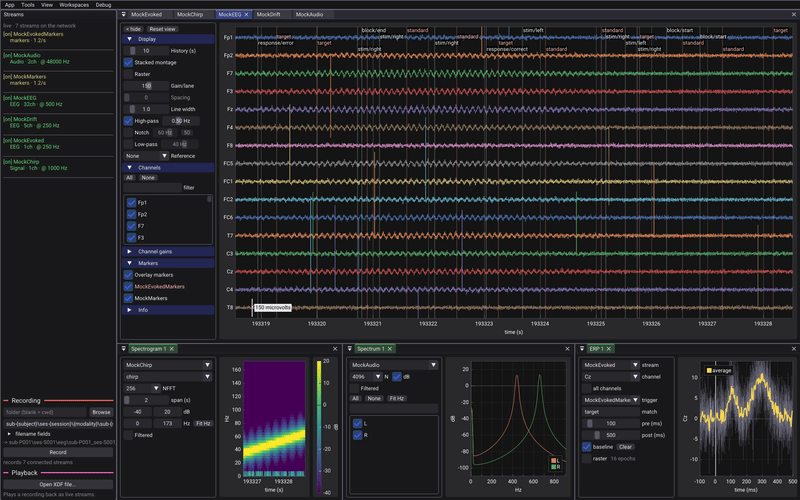
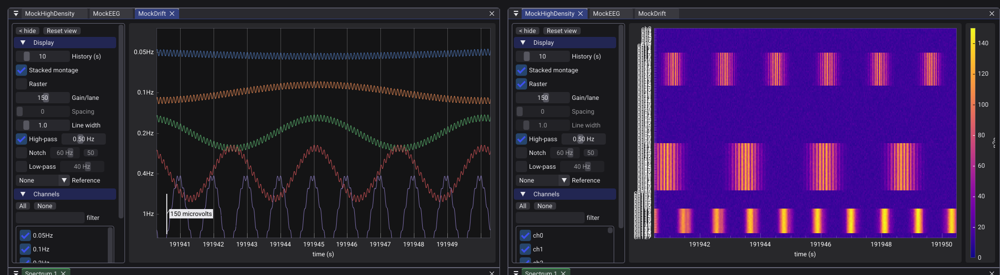
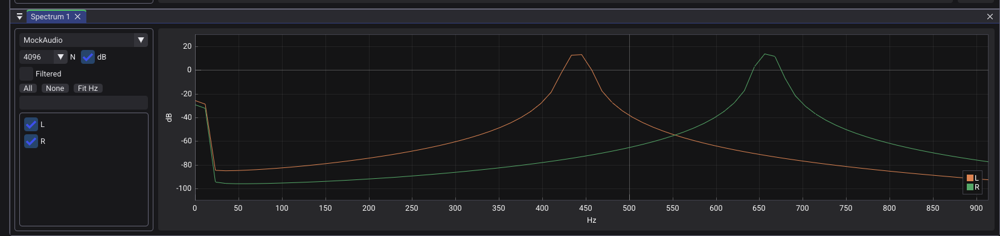
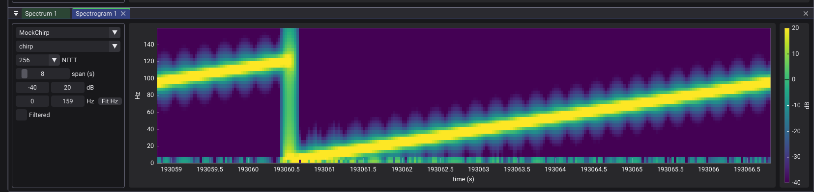
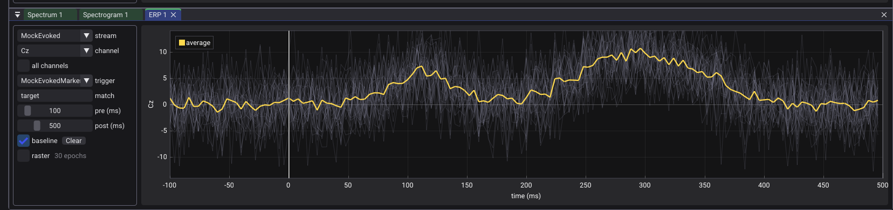

# lsl_viewer

A real-time viewer for [Lab Streaming Layer](https://github.com/sccn/labstreaminglayer) (LSL) streams. It plots live data (EEG, MEG, fNIRS, accelerometers, markers), applies display filters, computes spectra and marker-averaged responses, and records to XDF.



## Quick start

1. Download the viewer for your system from the [Releases page](https://github.com/aforren1/lsl-viewer/releases).
2. Start the viewer, and select **Tools > Emit demo streams**. The viewer then publishes a synthetic set of streams and shows them: EEG with EOG, a 1 Hz to 40 Hz chirp, a 48 kHz stereo tone, and an evoked-response stream with markers.
3. To use your own devices, click a stream in the **Streams** rail to connect it.

The [tutorial](docs/getting-started.md) goes through the installation, the plots, and a first recording.

## Features

### Live multi-stream time series



- A stacked montage with one named lane for each channel, or a shared-axis overlay.
- A raster (heatmap) mode for 32 to 256 channels or more.
- Pages of channels, a gain for each channel, and an auto-fit.
- Combined plots that show channels of several streams on one time axis.
- Locked time axes, so that all plots pan and zoom together.
- Dropouts that show as gaps at their real position in time.
- Marker streams that show as labeled event lines, and as a log.

See [View streams](docs/view-streams.md).

### Signal conditioning

- High-pass, mains notch (50 Hz or 60 Hz), and low-pass filters, in any combination.
- Re-referencing to the common average (CAR) or to one channel.

The filters change the display only. A recording holds the raw data.

### Frequency-domain analysis

| Per-channel FFT spectrum | Rolling spectrogram |
|---|---|
|  |  |

- A PSD for each selected channel, in dB or linear units.
- A rolling spectrogram with an adjustable frequency range.

### ERP and marker-aligned averaging



- Epochs around the events of a marker stream, averaged across trials, with the single-trial traces.
- Optional selection of the events by label.
- One channel or many channels, and a channels-by-time heatmap.

See [Analyze signals](docs/analysis.md).

### Recording and playback

- XDF recording of all connected streams. The files are compatible with LabRecorder.
- Filename templates with BIDS fields, such as `sub-{subject}_task-{task}_run-{run}_eeg.xdf`.
- Playback of a recording as live streams, at 0.5 to 20 times real time, to check a recording right after you make it.
- Two command-line tools that need no GPU or display: `xdf_record` records, and `xdf_replay` replays.

See [Record and replay](docs/record-and-replay.md).

### Remote control

A script can select the streams, set the file name, start and stop the recording, and copy the file, through a TCP port. Client libraries are available for Python, MATLAB, and GNU Octave.

```python
import lsl_viewer_rc as rc

with rc.Client("127.0.0.1", 22345) as viewer:
    viewer.select("all")
    viewer.set(subject="01", task="posner", run=1)
    viewer.start()
    # Present the stimuli here.
    viewer.stop()
```

See [Control the recording from a script](docs/remote-control.md).

### Other

- A docking layout, and saved workspaces that hold the streams, the filters, the analysis windows, and the layout.
- Information for each stream: the metadata, the measured rate, the clock offset, and the dropouts.
- A light theme and a dark theme, and an adjustable UI scale.

See [Workspaces and settings](docs/settings.md).

## System requirements

The viewer needs a GPU, a driver for one of the graphics APIs below, and a desktop display. The other requirements are small: a few hundred MB of RAM, and a recent multi-core CPU.

| System | Requirement |
|---|---|
| Windows | Windows 10 or later (64-bit), with Direct3D 12 or Vulkan. |
| macOS | macOS 11 (Big Sur) or later, on a Mac with Metal support. |
| Linux | A Vulkan driver, and Wayland or X11. The AppImage needs glibc 2.34 or later (for example Ubuntu 22.04 or Debian 12). |

The downloads are not code-signed. See the [tutorial](docs/getting-started.md#1-install-the-viewer) for the first launch.

**Network:** LSL finds the streams with UDP broadcast and multicast, and transfers the data with TCP. Thus the sources must be on the same subnet, and the firewall must permit the viewer. The Windows installer adds the firewall rules. On macOS 15 (Sequoia) and later, permit the local network when the system asks. If the viewer finds no streams, see [Troubleshooting](docs/troubleshooting.md).

**Command-line tools:** `xdf_record` and `xdf_replay` have no GPU or display requirements. The static builds for Linux run on all Linux distributions.

## Documentation

The [documentation index](docs/README.md) lists all pages.

| To do this | Read |
|---|---|
| Learn the viewer in ten minutes | [Get started](docs/getting-started.md) |
| Set up plots, channels, filters, and markers | [View streams](docs/view-streams.md) |
| Use the spectrum, the spectrogram, and the ERP | [Analyze signals](docs/analysis.md) |
| Record, name the files, and replay | [Record and replay](docs/record-and-replay.md) |
| Start the recording from an experiment script | [Control the recording from a script](docs/remote-control.md) |
| Save a view, or find the files of the viewer | [Workspaces and settings](docs/settings.md) |
| Correct a problem | [Troubleshooting](docs/troubleshooting.md) |
| Look up a menu item, a variable, or an option | [Reference](docs/reference.md) |

For developers and administrators:

- [docs/technical/network.md](docs/technical/network.md): the LSL ports and the firewall rules for each platform.
- [docs/technical/remote-control-protocol.md](docs/technical/remote-control-protocol.md): the TCP protocol of the remote control.
- [docs/technical/building.md](docs/technical/building.md): how to build from source, the CMake flags, and the repository layout.
- [DESIGN.md](DESIGN.md): the architecture and the reasons for it.

## Roadmap

- Scalp topography (topomap): an interpolated head map of the amplitude or the band power. The viewer already reads the sensor positions for each channel from the stream metadata, thus the map can apply to EEG, MEG, or fNIRS. The Info panel shows how many channels have a layout.
- Bipolar montages: named electrode chains, such as the longitudinal "double banana".
- Drag-and-drop of markers onto a plot, and more marker and event controls.
- Manual rejection of bad channels, which excludes them from the CAR and from the display.

## License

MIT. See [LICENSE](LICENSE). The viewer includes third-party components (SDL3, Dear ImGui, ImPlot, liblsl, KissFFT, spdlog, the Roboto font, and the components that they bundle), and it adapts the `xdfwriter` of LabRecorder. Their copyright notices and licenses are in [THIRD_PARTY_LICENSES](THIRD_PARTY_LICENSES). To see the version and the licenses in the viewer, select **App > About**.

## Acknowledgments

Built with [SDL3](https://github.com/libsdl-org/SDL) and SDL_GPU, [Dear ImGui](https://github.com/ocornut/imgui) (docking) with [ImPlot](https://github.com/epezent/implot), [liblsl](https://github.com/sccn/liblsl), and [KissFFT](https://github.com/mborgerding/kissfft). C++20.

Thanks to the developers of LSL, SDL, Dear ImGui, ImPlot, spdlog, KISS FFT, and Tracy for these useful and foundational tools.

I used AI (Claude Opus 4.8 and later models) to help me develop this tool.
