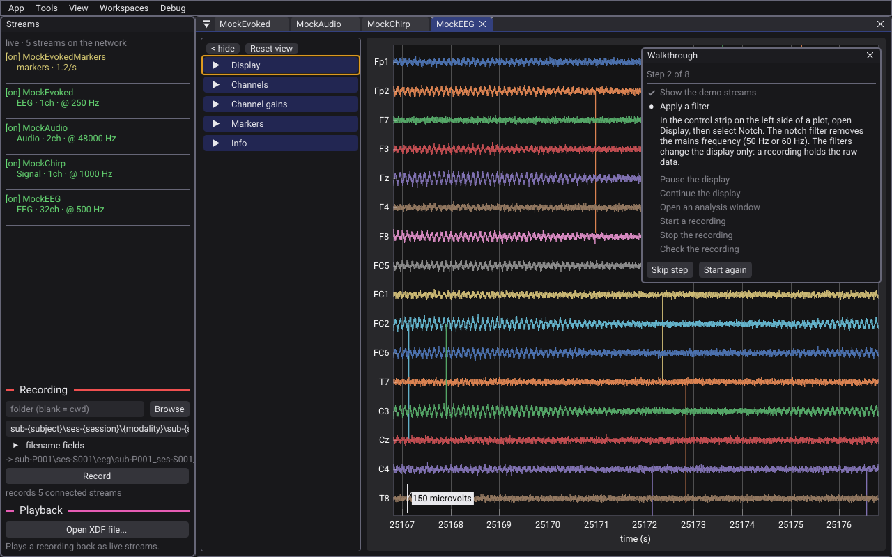

# Get started

This tutorial takes about ten minutes. You install the viewer, and then the built-in walkthrough takes you through the demo streams, a filter, an analysis window, and a short recording. You do not need an amplifier or other LSL source.

## 1. Install the viewer

Download the file for your system from the [Releases page](https://github.com/aforren1/lsl-viewer/releases).

| System | File | Notes |
|---|---|---|
| Windows | `lsl-viewer-setup.exe` (installer) | The installer adds the firewall rules that LSL needs. |
| Windows | `lsl-viewer-windows.zip` (portable) | No installation. Extract the folder and run `lsl_viewer.exe`. Windows asks about the firewall at the first launch. Select **Allow**. |
| macOS | `LSL-Viewer.dmg` | Drag **LSL Viewer** to **Applications**. |
| Linux | `LSL-Viewer-<arch>.AppImage` | Make the file executable (`chmod +x`), then run it. |

The files are not code-signed. Thus the first launch shows a warning:

- **Windows:** in the SmartScreen dialog, select **More info**, then **Run anyway**.
- **macOS:** right-click the application and select **Open**.

On macOS 15 (Sequoia) and later, the system asks if the viewer can find devices on the local network. Select **Allow**. If you refuse, the viewer finds no streams.

For the hardware and system requirements, see the [README](../README.md#system-requirements).

## 2. Run the walkthrough

The viewer has a built-in walkthrough. It takes you through the main features on synthetic demo streams, in the real window.

1. Start the viewer.
2. Select **Tools > Walkthrough**.
3. Do the step that the **Walkthrough** panel shows. An amber frame shows the control or the menu to use.

The walkthrough completes a step when you do it, and then shows the next one. There is no button to confirm a step. You can move the panel, and you can close it at any time.

| Button | Effect |
|---|---|
| **Skip step** | Goes to the next step. Use it for a step that you do not want to do, such as the recording. |
| **Start again** | Goes back to the first step. A step whose result is already there completes immediately. |

The walkthrough has these steps:

1. Show the demo streams.
2. Apply a filter.
3. Pause the display, and continue it.
4. Open an analysis window.
5. Start a recording, and stop it.
6. Check the recording in **Playback**.

The recording step writes a small file to your recording folder. The default folder is `Documents/lsl-recordings`.

## 3. Look around

When the walkthrough is complete, the window looks almost the same as this image:

- The **Streams** rail on the left lists the streams that LSL finds on the network. A connected stream has `[on]` before its name.
- Each data stream is a plot tab. The control strip on the left side of a plot has the display settings, the filters, and the channels.
- The analysis windows are in the row below the plots.
- The **Recording** and **Playback** sections are at the bottom of the rail.

The demo has these streams:

| Stream | Contents |
|---|---|
| `MockEEG` | EEG with EOG channels. |
| `MockChirp` | One channel that sweeps from 1 Hz to 40 Hz. |
| `MockAudio` | A stereo tone at 48 kHz. |
| `MockEvoked` | One channel with an evoked response. |
| `MockEvokedMarkers` | The markers that go with `MockEvoked`. |

To stop the demo streams, select **Tools > Emit demo streams** again.

## Next steps

- To use your own devices, see [View streams](view-streams.md).
- To name the files for a study, see [Record and replay](record-and-replay.md).
- To start the recording from an experiment script, see [Control the recording from a script](remote-control.md).
- If the viewer does not show the streams of a different machine, see [Troubleshooting](troubleshooting.md).
