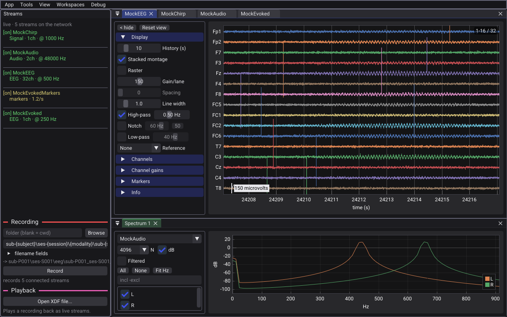
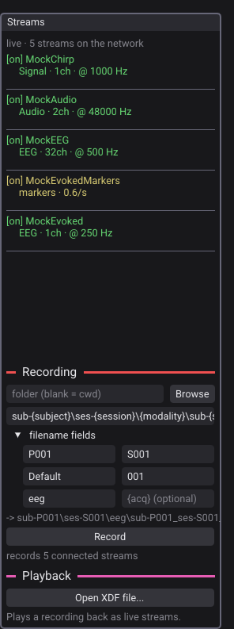

# Get started

This tutorial takes about ten minutes. You install the viewer, look at the built-in demo streams, apply a filter, and make a short recording. You do not need an amplifier or other LSL source.

## 1. Install the viewer

Download the file for your system from the [Releases page](https://github.com/aforren1/lsl-viewer/releases).

| System | File | Notes |
|---|---|---|
| Windows | `lsl-viewer-setup.exe` (installer) | The installer adds the firewall rules that LSL needs. |
| Windows | `lsl-viewer-windows.zip` (portable) | No installation. Extract the folder and run `lsl_viewer.exe`. Windows asks about the firewall at the first launch. Select **Allow**. |
| macOS | `LSL-Viewer.dmg` | Drag **LSL Viewer** to **Applications**. |
| Linux | `LSL-Viewer-<arch>.AppImage` | Make the file executable (`chmod +x`), then run it. |

The files are not code-signed. Thus the first launch shows a warning:

- **Windows:** in the SmartScreen dialog, select **More info**, then **Run anyway**.
- **macOS:** right-click the application and select **Open**.

On macOS 15 (Sequoia) and later, the system asks if the viewer can find devices on the local network. Select **Allow**. If you refuse, the viewer finds no streams.

For the hardware and system requirements, see the [README](../README.md#system-requirements).

## 2. Start the demo streams

1. Start the viewer. The **Streams** rail is on the left side of the window. It shows the streams that LSL finds on the network.
2. Select **Tools > Emit demo streams**.

The viewer now publishes five synthetic streams and connects to them:

| Stream | Contents |
|---|---|
| `MockEEG` | EEG with EOG channels. |
| `MockChirp` | One channel that sweeps from 1 Hz to 40 Hz. |
| `MockAudio` | A stereo tone at 48 kHz. |
| `MockEvoked` | One channel with an evoked response. |
| `MockEvokedMarkers` | The markers that go with `MockEvoked`. |

Each data stream opens as a plot tab. A connected stream has `[on]` before its name in the rail.

The window in this image also has a spectrum, which you open in step 4.

## 3. Look at a stream

1. In the rail, click `MockEEG`. The viewer brings its plot to the front.
2. In the control strip on the left side of the plot, open **Display**.
3. Move **History (s)** to change the length of the time window.
4. Select **High-pass**. The slow drift goes out of the traces.
5. Push the **P** key. The plots stop. Push **P** again to continue.

The marker events show as labeled vertical lines on the plots.

## 4. Open an analysis window

1. Select **View > New spectrum**.
2. In the **stream** list of the new window, select `MockAudio`.
3. Select **Fit Hz**. The frequency axis now shows only the band that holds the tones.

## 5. Make a recording

The **Recording** section is below the stream list in the rail.

1. Look at the line that starts with `->`. It shows the full path of the file that the viewer will write.
2. Select **Record**. The right side of the menu bar shows `[REC ...]` with the time and the file size.
3. After some seconds, select **Stop recording**.

The recording holds all connected streams. The default folder is `Documents/lsl-recordings`.

## 6. Check the recording

1. Select **Tools > Emit demo streams** again to stop the demo streams.
2. In the **Playback** section of the rail, select **Open XDF file...** and then the file that you recorded.

The viewer plays the file back as live streams. Use the position slider, the speed list, and **Loop** to examine the recording.

## Next steps

- To use your own devices, see [View streams](view-streams.md).
- To name the files for a study, see [Record and replay](record-and-replay.md).
- To start the recording from an experiment script, see [Control the recording from a script](remote-control.md).
- If the viewer does not show the streams of a different machine, see [Troubleshooting](troubleshooting.md).
